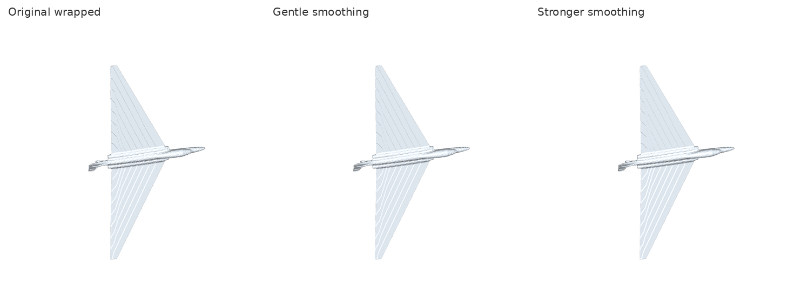
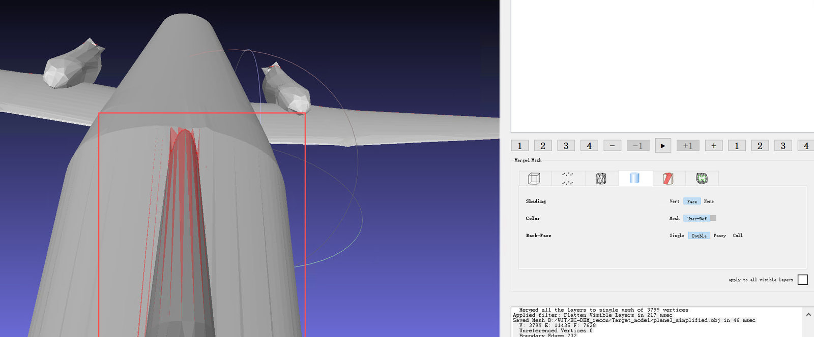
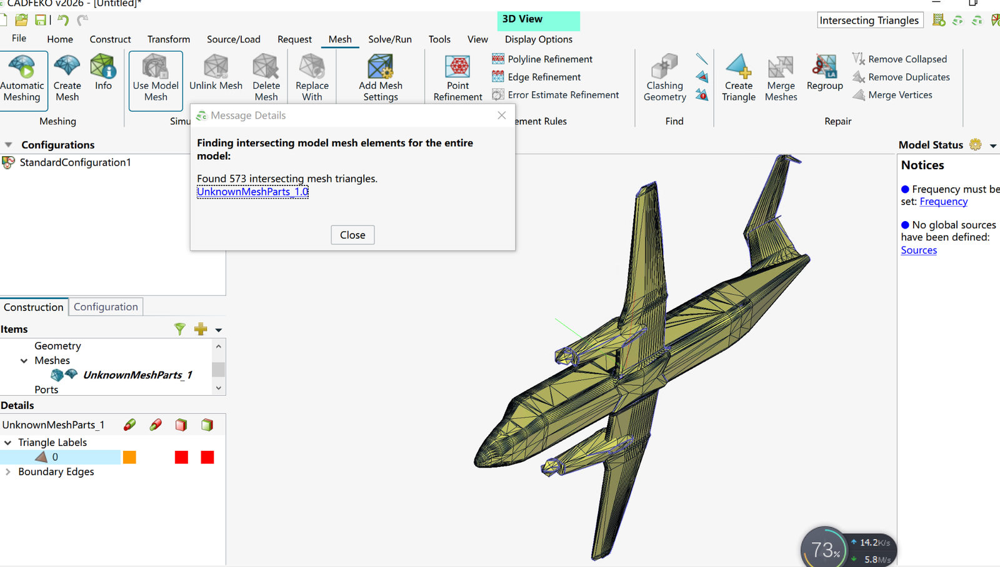

# FEKO PEC Mesh Repair

**Codex Skill + MeshLab/Python/CADFEKO 2026 workflow** for repairing imperfect aircraft OBJ/STL meshes into **audited candidates** for PEC MoM/MLFMM electromagnetic simulations.

[中文教程](README.zh-CN.md) · [MeshLab illustrated walkthrough](docs/meshlab-workflow.zh-CN.md) · [FEKO validation checklist](docs/feko-validation.zh-CN.md) · [Repair case studies](docs/cases.zh-CN.md) · [Skill instructions](SKILL.md)



> [!IMPORTANT]
> **Watertight ≠ electromagnetically validated.** A closed 2-manifold may still have spurious handles, distorted wing thickness, missing nacelles, poor PEC contacts, or unresolved mesh artifacts. Run CADFEKO intersection/connectivity checks and complex-field mesh convergence before claiming full-wave validity. Open PEC sheets can also be physically valid and need not be sealed indiscriminately.

## What is included?

| Item | Content |
| --- | --- |
| `SKILL.md` | Agent workflow and safety/acceptance gates for Codex |
| `scripts/mesh_pipeline.py` | Four CLI commands: `audit`, `clean`, `reconstruct`, `compare` |
| `docs/meshlab-workflow.zh-CN.md` | **Screenshot-guided** cleanup, boundaries, connected components and safe simplification |
| `docs/feko-validation.zh-CN.md` | FEKO 2026: intersecting triangles, connectivity, mesh size and convergence |
| `docs/cases.zh-CN.md` | Real Plane-3/Plane-4 repair lessons, including failed candidates |
| `assets/` | Screenshots provided by the project author and before/after visualizations |
| `tests/` | Unit tests for mesh statistics, cleanup, winding and candidate reconstruction |

### Example: what to inspect

| MeshLab: identify malformed or intentional boundaries | CADFEKO: validate actual PEC geometry |
| --- | --- |
|  |  |
| Red selection may include valid adjacent facets. **Do not delete all selected faces.** | The pictured older Plane-3 candidate reported intersecting triangles. It is a **failure example**, not the accepted mesh. |

## Install locally

Requires Python 3.10+ and MeshLab for inspection. FEKO is a separate proprietary application and is **not** included.

```powershell
cd feko-pec-mesh-repair
python -m venv .venv
.\.venv\Scripts\Activate.ps1
python -m pip install -r requirements.txt
python -m pytest -q tests
```

To enable the Codex Skill, copy the repository folder to a Codex skills directory configured on your machine (for example, `~/.codex/skills/feko-pec-mesh-repair/`). The entry point is `SKILL.md`.

## Quick start

```powershell
python scripts/mesh_pipeline.py audit  "plane4_simplified.obj" --json "out/audit.json"
python scripts/mesh_pipeline.py clean  "plane4_simplified.obj" --output "out/clean.obj" --json "out/clean.json" --orient-two-face-edges
```

Only after **human approval of geometry-changing reconstruction**:

```powershell
python scripts/mesh_pipeline.py reconstruct "out/clean.obj" --output "out/wrapped_candidate.obj" --json "out/reconstruct.json" --pitch 0.02 --close-voxels 1 --smooth-iters 4
python scripts/mesh_pipeline.py compare "out/clean.obj" "out/wrapped_candidate.obj" --json "out/compare.json" --png "out/compare.png"
```

`--pitch` is expressed in the source model's coordinate units; `0.02` means 20 mm only if the source is in metres. The resulting wrapped model is **not automatically FEKO-ready**. See the [complete guide](README.zh-CN.md).

## Verification gates

1. **Topology candidate:** report face counts, border/nonmanifold edges, winding, components, orientability and valid Euler/genus assumptions.
2. **Geometry accepted:** inspect 3-view silhouettes, wing thickness/leading and trailing edges, nacelles and tail, scale, surface ripples and unintended mergers.
3. **FEKO model checked:** import STL with correct units, run **Mesh → Find → Intersecting Triangles**, inspect **Display Options → Connectivity** and PEC electrical contacts.
4. **EM validated:** converge the complex scattered electric field/RHS with at least two appropriate solver mesh settings; preserve source phase convention and traceable mesh revision.

## Scope and attribution

The illustrated screenshots were supplied by the project author during the Plane-3/Plane-4 repair workflow. Example OBJ/STL meshes and licensed FEKO projects are **not redistributed** in this repository. Reported case statistics describe the particular meshes shown and are not generic performance guarantees.

This repository does not include a software license by default. Choose a license before distributing the code under open-source reuse terms. FEKO and MeshLab belong to their respective owners; screenshots are used for documentation, not to imply endorsement.
