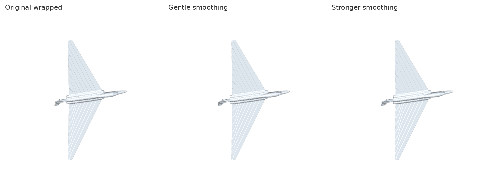
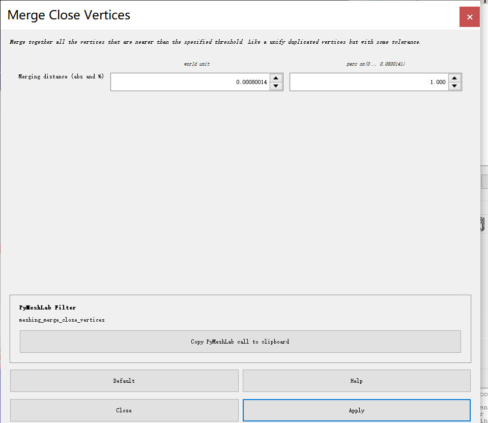
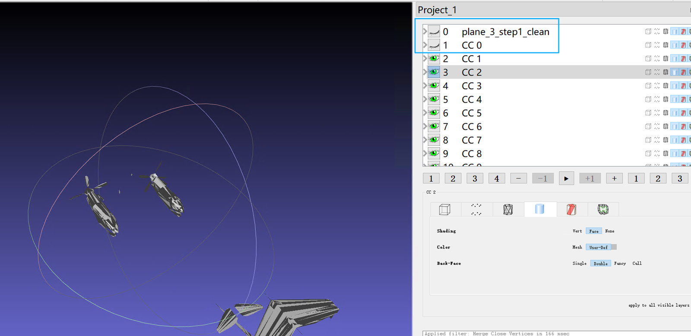
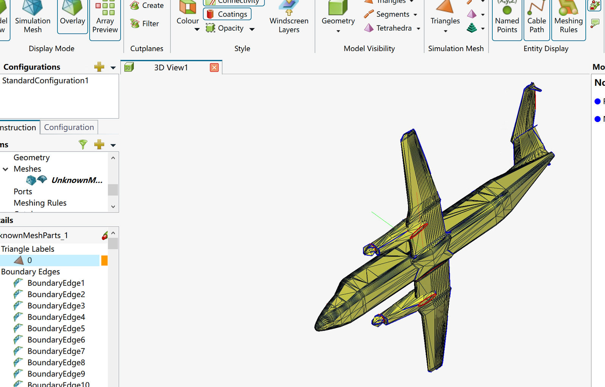
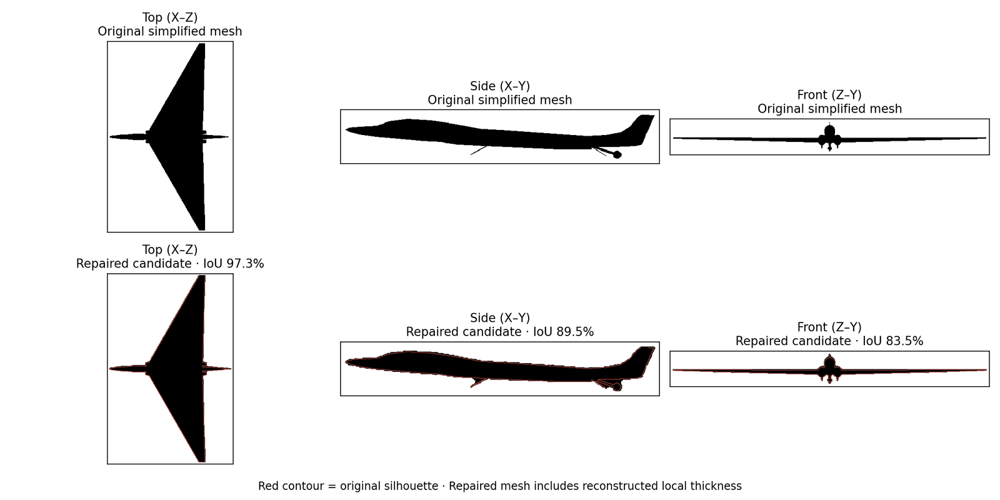

# FEKO PEC Mesh Repair：三维 OBJ 网格修复 Codex Skill

这是一个基于 Plane-3 和 Plane-4 实际处理经验的 **MeshLab → Python → CADFEKO 2026** 工作流，用于把缺面、非流形、法向混乱或表面交叉的 OBJ/STL 整理成 **可审核的 PEC 全波仿真候选几何**。



**[MeshLab 全流程图文教程](docs/meshlab-workflow.zh-CN.md)** · **[CADFEKO 2026 验收教程](docs/feko-validation.zh-CN.md)** · **[Plane-3 / Plane-4 实例与失败教训](docs/cases.zh-CN.md)** · **[Codex Skill](SKILL.md)**

> **原则**：优先保留真实飞机几何、翼面厚度与 PEC 电气连接。水密、Genus=0、相交检测为零分别是重要检查，但并不能单独证明散射回波准确。薄 PEC 片体有时可以保持开放，不应为了达到水密指标盲目封口。

## 流程总览

| 步骤 | 软件 | 目标 |
| --- | --- | --- |
| 1. 导入并备份 OBJ | MeshLab | 保留原始文件，确认单位、尺寸、姿态 |
| 2. 保守清理 | MeshLab | 去除重复顶点/面、零面积面、无引用顶点 |
| 3. 边界诊断 | MeshLab | `Select Border`、`Select non Manifold Edges`、拓扑统计 |
| 4. 检查连通组件 | MeshLab | 隐藏/显示 `CC` 层，谨慎保留机身、机翼、尾翼和发动机 |
| 5. 合并可见模型 | MeshLab | `Flatten Visible Layers`，导出 `*_simplified.obj` |
| 6. 安全清理与绕序修正 | Python/Codex | 输出可追溯的清理版本，不破坏原始几何 |
| 7. 必要时水密重建 | Python/Codex | 生成**可能改变几何**的候选，核查 Genus、轮廓、翼厚及部件 |
| 8. FEKO 验收 | CADFEKO 2026 | 相交面、Connectivity、单位、PEC 连接与复数散射场收敛 |

## 第一阶段：MeshLab GUI

完整截图和注意事项见 [图文教程](docs/meshlab-workflow.zh-CN.md)。

**导入 OBJ** 后，在 `Filters → Cleaning and Repairing` 执行：

1. `Remove Duplicate Vertices`
2. `Remove Duplicate Faces`
3. `Remove Zero Area Faces`
4. `Remove Unreferenced Vertices`

调整显示为 `Shading = Face`、`Back-Face = Double`，关闭 `Wireframe`；使用 `Select Border` 检查开放边。发现未焊接的重合顶点时，可以用 `Merge Close Vertices` 做**小容差试验**，例如输入模型以米计时先试 `0.00001`（0.01 mm）。若合并数量为零，也属于有效诊断结果，**不要随意增加容差**。



然后执行 `Split in Connected Components`，逐个显示/隐藏 CC 图层，**确认每个独立部件的物理意义**，最后合并拟保留的可见组件。



> 删除螺旋桨、某些天线或小结构属于**有损几何简化**。应将此决定写进修复日志，且 FK 投影、FEKO 全波输入和 DDRI 几何真值必须一致。不能只为了使网格连通或水密而删除真实结构。

## 第二阶段：Python 审计 / 修复

环境：Python 3.10+，建议独立虚拟环境。

```powershell
python -m venv .venv
.\.venv\Scripts\Activate.ps1
python -m pip install -r requirements.txt
python -m pytest -q tests
```

先运行无损审计与保守修复：

```powershell
python scripts/mesh_pipeline.py audit "plane_simplified.obj" --json "out/audit.json"
python scripts/mesh_pipeline.py clean "plane_simplified.obj" --output "out/plane_safe.obj" --json "out/clean.json" --orient-two-face-edges
```

程序输出顶点/面数、开放边、非流形边、绕序不一致、重复面、连通分量、包围盒及最大三角边长等信息。`clean` 不自动填洞、不强制焊接不同部件，也不推断实体厚度。法向绕序修正不能替代正确的拓扑连接。

如果确实需要封闭实体，**先人工批准有损重建**，再运行：

```powershell
python scripts/mesh_pipeline.py reconstruct "out/plane_safe.obj" --output "out/plane_wrapped_candidate.obj" --json "out/reconstruct.json" --pitch 0.02 --close-voxels 1 --smooth-iters 4
python scripts/mesh_pipeline.py compare "out/plane_safe.obj" "out/plane_wrapped_candidate.obj" --json "out/compare.json" --png "out/compare.png"
```

`--pitch` 使用模型本身的坐标单位。**体素重建可能制造微小通道、增厚薄翼、消失发动机或在表面产生规则脊线**；不能将其自动标记为最终模型。

## 第三阶段：CADFEKO 2026 验收



- 导入目标 OBJ/STL，确认单位和包围盒。**STL 不携带单位**。
- 在 `Mesh → Find → Intersecting Triangles` 运行全模型相交检查，并记录原始提示。
- `Display Options → Connectivity` 检查开放/未连接区域；**蓝色线条通常只是网格边/轮廓显示，不能作为几何错误的证据**。
- 重要 PEC 接触位置需要正确电气连通，仅将网格图层合并并不保证导体连续。
- 最后才建立 3 GHz MoM/MLFMM 仿真，做至少两档电磁网格的**复数电场或 RHS 收敛验证**。12.5 mm 只是一个历史实验尺度，并非通用合格标准。

更多截图：[FEKO 验收教程](docs/feko-validation.zh-CN.md)。

## 真实修复经验

**Plane-3：** 原简化模型存在 169 条非流形边、232–234 条开放边。第一次全局包裹重建虽然水密，但 Genus 高达 955；后续过度清理曾使一侧发动机短舱部分缺失。后续候选恢复发动机、重新检查拓扑，并在本地 FEKO 得到无相交三角面的反馈。

**Plane-4：** 简化模型约 2,527 个三角面，翼面由大型三角片定义。水密重建可以消除开放边/非流形边，但也引入周期性翼面脊线，且侧视/正视轮廓偏移不能忽略。应优先利用原始翼型重新构建表面，不能反复全局平滑来代替几何建模。



**完整案例与被拒绝的修复方案**：见 [docs/cases.zh-CN.md](docs/cases.zh-CN.md)。

## 用作 Codex Skill

将本文件夹放进 Codex 已配置的 Skill 目录，例如：

```powershell
Copy-Item -Recurse -Force ".\feko-pec-mesh-repair" "$HOME\.codex\skills\feko-pec-mesh-repair"
```

之后可要求 Codex：

> 使用 `$feko-pec-mesh-repair` 审计 OBJ；先生成安全清理文件与统计报告，明确不能自动判断的翼身连接；必要时提供有损水密候选，附三视图偏差与 FEKO 验收清单。

软件不直接调用 FEKO 求解器、不保证自动完成模型修复，也不包含原始飞机 OBJ、STL 或商业 FEKO 工程。请在发布开源仓库时自行选择许可协议。
