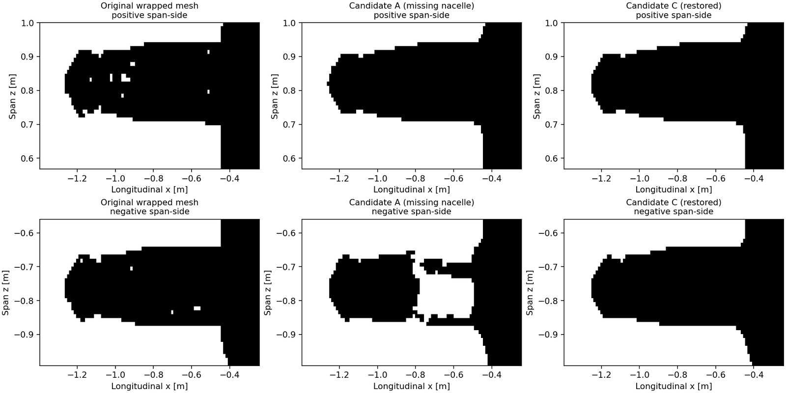
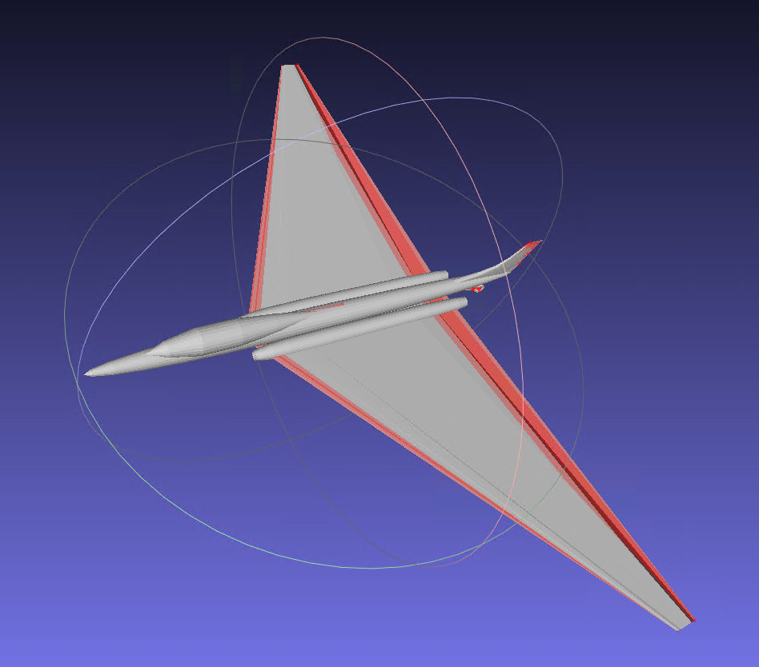
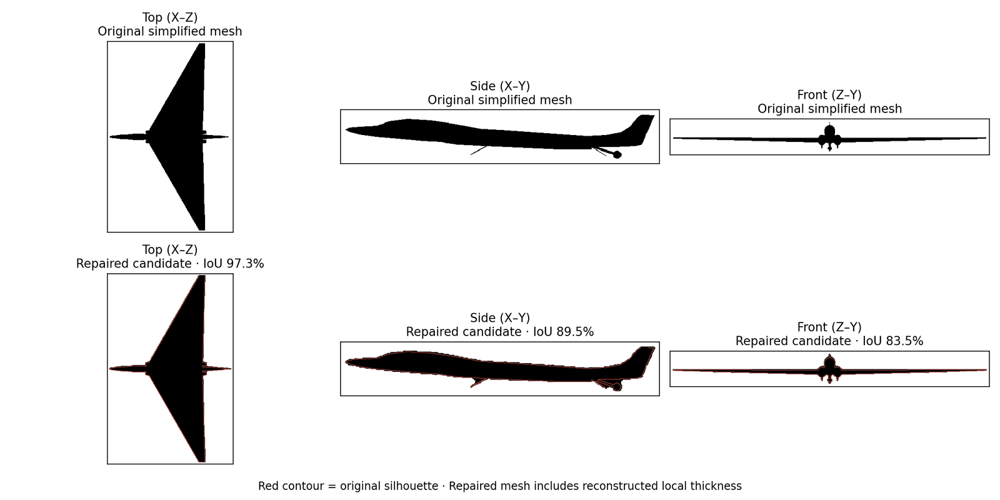
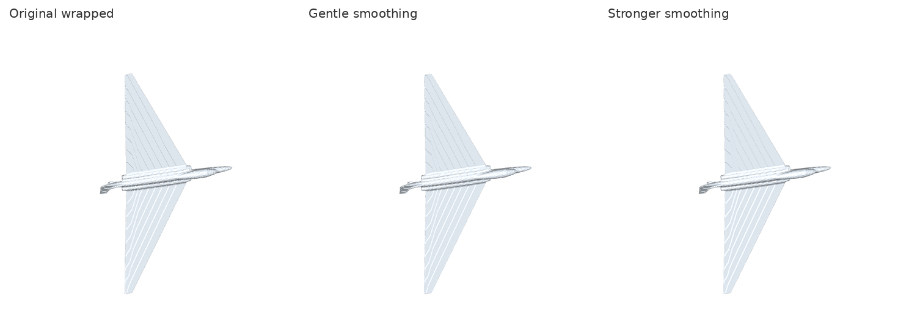

# 实际修复经验：Plane-3 和 Plane-4

[返回首页](../README.zh-CN.md)

这些数据来自本项目的真实操作记录，旨在说明**成功与失败的判断依据**。具体数值对应当时的网格修订版本，不代表本工具对任意模型的保证，也不包含原始 3D 模型数据。

## Plane-3：水密网格仍可能不可信

### 从 MeshLab 拓扑诊断开始

- 简化模型：7,628 个三角面；169 条非流形边；232 条开放边；4 个连通组件。
- 保守清理与绕序调整删除了 1 个重复面，但没有凭空“修好”169 条复杂多面交汇。
- 初次水密重建：779,408 个三角面、0 开放边、0 非流形边、1 连通组件，却出现了 **Genus=955**。

**教训**：`watertight=True` 只代表拓扑约束的一部分。Genus=955 对普通飞机外形很可疑，意味着可能存在大量小尺度穿孔/通道，需要检查曲面质量。

### 消失的发动机

后续为了降低拓扑通道数量，有一个候选模型在“只保留最大连通组件”的操作中丢失了一侧发动机短舱中后段。最终又结合原几何进行了恢复和重新验证。

**教训**：不能为了得到“1 连通组件 / Genus 0”自动把其他几何都当碎片丢掉。要在交付前成对检查两个发动机、主翼、尾翼和其他对称结构。恢复的几何也需要重新做 FEKO 相交测试。

### FEKO 实际检查

早期未经修正的模型在 FEKO 报告 `Found 573 intersecting mesh triangles`。用户后来对恢复发动机的候选网格执行了检查，返回：`No intersecting mesh elements found in the model mesh.`

两项记录共同说明**每次新的几何版本都要重新检查**；不要把旧版 FEKO 验收结果沿用到新版模型。

## Plane-4：超薄三角翼及表面脊线

### 从原始翼面出发

Plane-4 的简化 OBJ 约 2,527 个三角面，翼面由较大的三角片表示。三角翼平面轮廓很清楚，但上下蒙皮连接、厚度、部件相交需要后续修复。

### 水密重建后的轮廓比较

一版精细候选约 309,156 面、单连通、水密、Genus=0；经过 CADFEKO 网格相交检查，用户确认未发现相交三角面。但由于翼型厚度被重新构造，其侧视和正视轮廓差异比俯视更大。

**教训**：二维投影 IoU 高，仍不能证明金属翼厚、表面曲率及 PEC 电流散射与原始几何一致。

### 为什么 Taubin 平滑没能完全解决锯齿？

三角翼水密重建后出现沿翼展周期性的脊线。在 FEKO 中关闭 Edges 仍能观察到真实的表面形状变化。保守的 Taubin 光顺可减弱微小锯齿，但较长的脊线仍存在；强制贴近源翼面的一次尝试导致约 14.6% 的体积变化，已被拒绝作为正式网格。

**教训**：对结构化薄翼，最好基于原始上/下翼面重新构造平顺的曲面及真实翼厚，然后局部切分/封口；无限制全局平滑可能损害翼尖或机翼后缘。

## 跨项目共同标准

1. **物理含义优先**：开放 PEC 薄片可能完全合理；强制水密不可替代正确的模型假设。
2. **记录所有有损变化**：移除螺旋桨、包裹重建、封闭开口、加厚薄翼都应明确披露。
3. **防止数值自证**：FEKO、FK/PO 和 DDRI 的 GT 必须基于同一个经确认的几何版本；若修复后的模型明显偏离原始结构，不可把它称作原飞机的精确全波验证。
4. **保留失败结果**：保存变更日志、相交面检查结果、重建前后对比和求解器参数。
