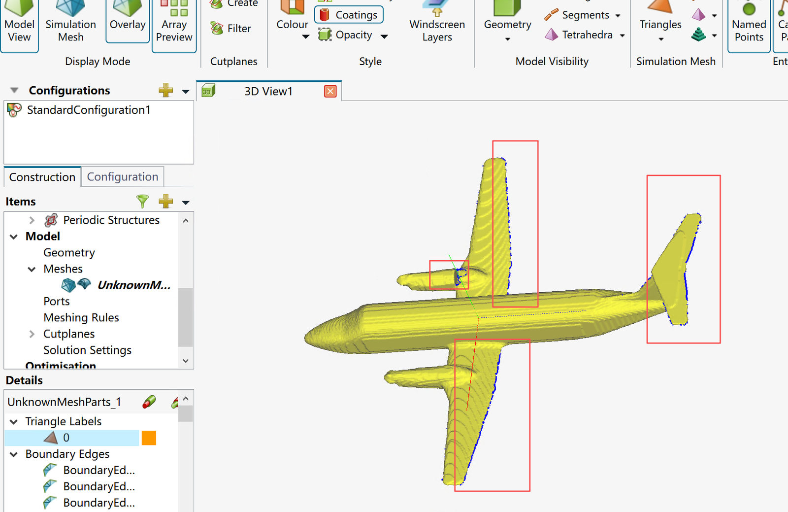
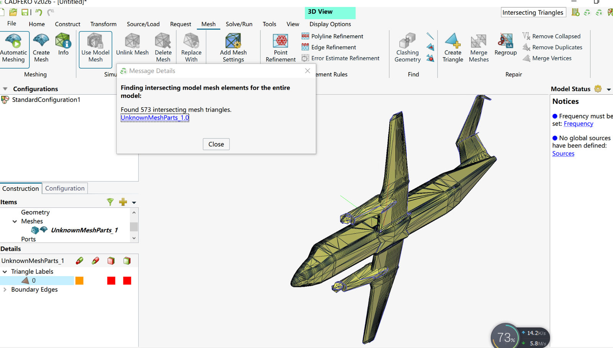
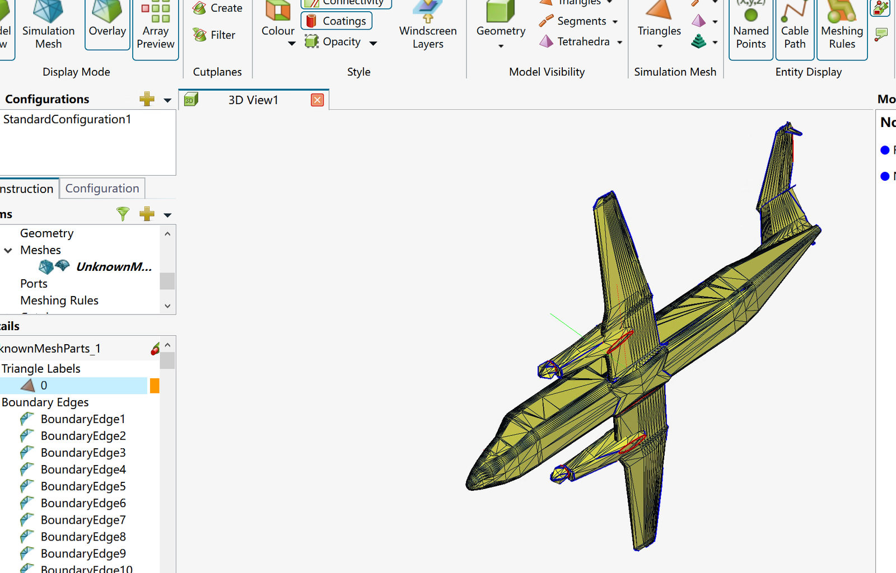
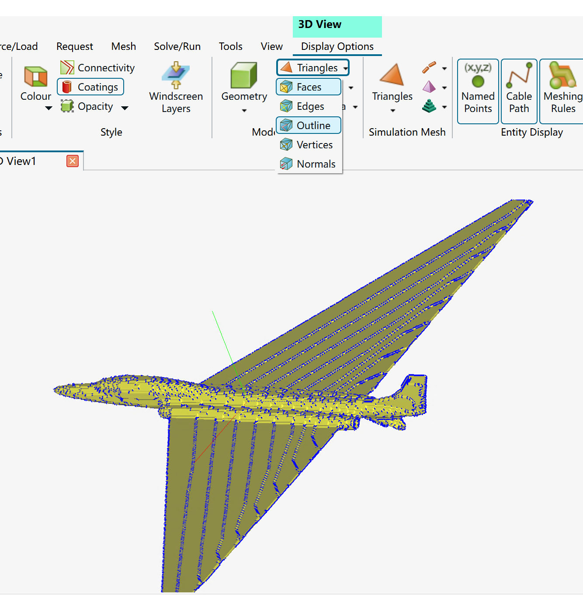
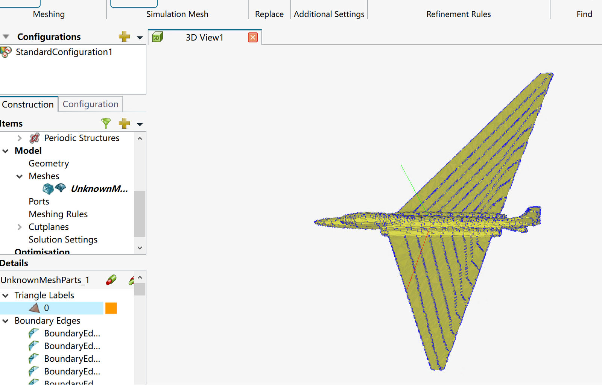

# CADFEKO 2026：OBJ/STL 几何与 PEC 仿真验收

[返回首页](../README.zh-CN.md) · [MeshLab 修复指南](meshlab-workflow.zh-CN.md)

> 这里描述 **CADFEKO 2026 的验收流程**，不依赖 FEKO 的闭源接口自动执行。单纯水密并不保证 PEC 电流连通、真实几何保真或全波结果可靠。

## 1. 导入 STL / OBJ，核对几何尺度

在 CADFEKO 新工程导入模型，确认：

- 单位：STL **不保存**单位，应确认输入原点和 XYZ 范围与源 OBJ 一致。
- 机身、机翼、尾翼、发动机是否存在且位置正确。
- 机翼厚度、翼根、翼尖有无明显体素重建纹路或异常融合。

## 2. Mesh → Find → Intersecting Triangles

- 对 `Entire Model` 运行相交三角面查找。
- 保存提示原文、FEKO 版本及模型文件哈希。
- 若报告 `Found N intersecting mesh triangles`，N 是**三角面数量**，不是相交面“对数”，需要分析具体位置和 PEC 接触关系。
- 若报告 `No intersecting mesh elements found in the model mesh`，表示该项网格相交检查通过；仍要检查翼型、金属连续性与求解收敛。

**失败实例：早期 Plane-3 候选曾报告 573 个相交三角面**，用于说明检查步骤，不能误认作合格模型。

## 3. Display Options → Connectivity

打开 Connectivity，检查异常开放边和 PEC 接触。**蓝色线条通常属于模型网格边或几何轮廓显示，并不自动表示非流形或相交错误。** 需要区分红色连接提示、意图开放的金属边缘和普通绘图线。

打开 `Display Options → Triangles` 下拉菜单，可以单独开关 `Faces`、`Edges`、`Outline`，用于分辨“蓝线只存在于显示”还是“真实表面具有锯齿脊线”。

**注意**：即使关闭线框，体素重建的真实表面仍可能具有周期性脊线。此时应检查原始翼型、截面厚度、三视图轮廓，而不是为了视觉光滑无限制平滑。

## 4. 正式电磁仿真前的最后一道关

1. 固定已经审查的几何版本，不在 FEKO、FK 投影和 DDRI 真值之间混用不同 STL/OBJ。
2. 确认 PEC、目标尺寸/姿态、频率及收发机与极化约定。
3. 检查是否真的需要将接触部件电气连接；体素包裹生成的一块水密壳体可能改变原设计的接触物理。
4. 设置 MoM/MLFMM 的电磁网格。对于 3 GHz，12.5 mm 仅是一个经验起点，**不是通用精度保证**。
5. 在相同 Tx/Rx、同一几何版本下做至少两档网格密度的复数场收敛：

\[
\epsilon_{\rm mesh}=\frac{\|\mathbf s_{\rm fine}-\mathbf s_{\rm coarse}\|_2}{\|\mathbf s_{\rm fine}\|_2}.
\]

6. 全过程保存 FEKO 求解日志、网格面数、求解残差、运行时间和 `Ex/Ey/Ez` 复数场。**禁止对每个分段任意拟合复增益**以人为改善一致性。

## 建议的结果等级

| 等级 | 最低要求 |
| --- | --- |
| `TOPOLOGY_CANDIDATE` | Python/MeshLab 拓扑审计完成 |
| `GEOMETRY_ACCEPTED` | 人工对比原始翼型、尾翼、发动机和尺度 |
| `FEKO_MODEL_CHECKED` | 相交检查、连接关系及单位通过 |
| `EM_VALIDATED` | MLFMM 求解完成，复数场网格收敛通过 |

不要因为相交检查结果为 0 就直接标为 `EM_VALIDATED`。
