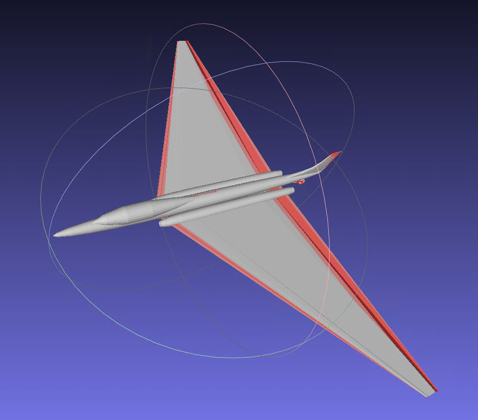
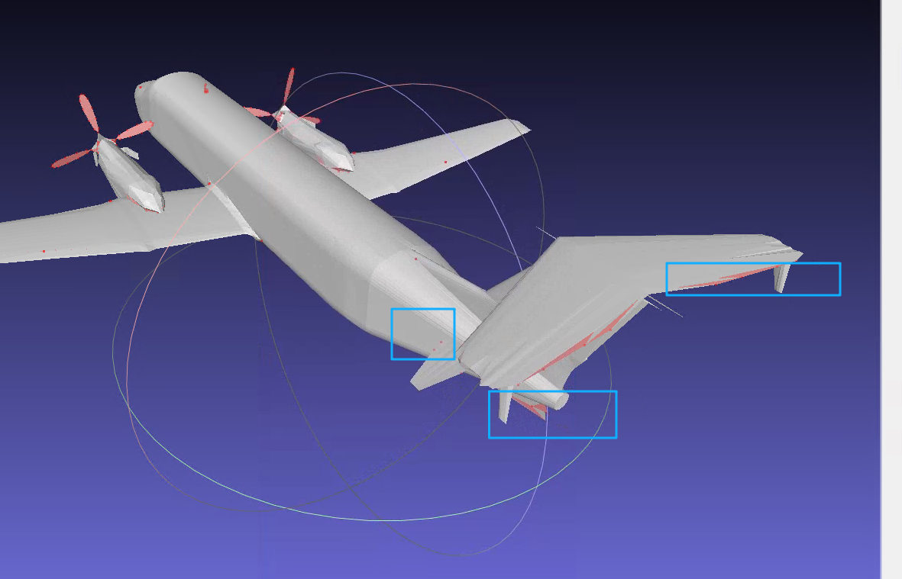
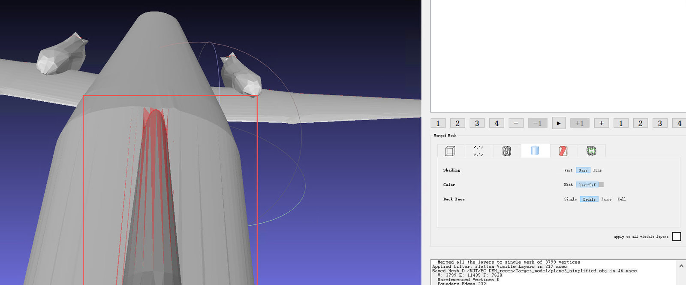
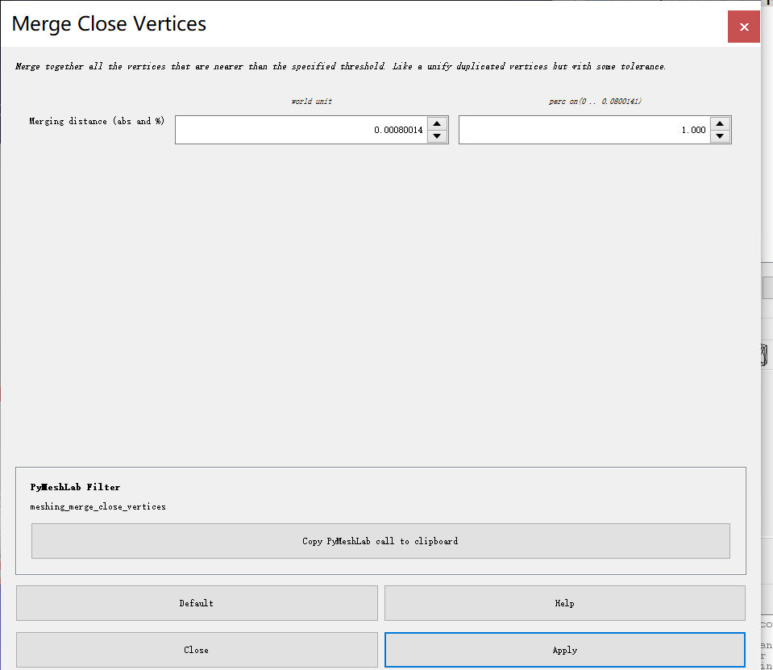
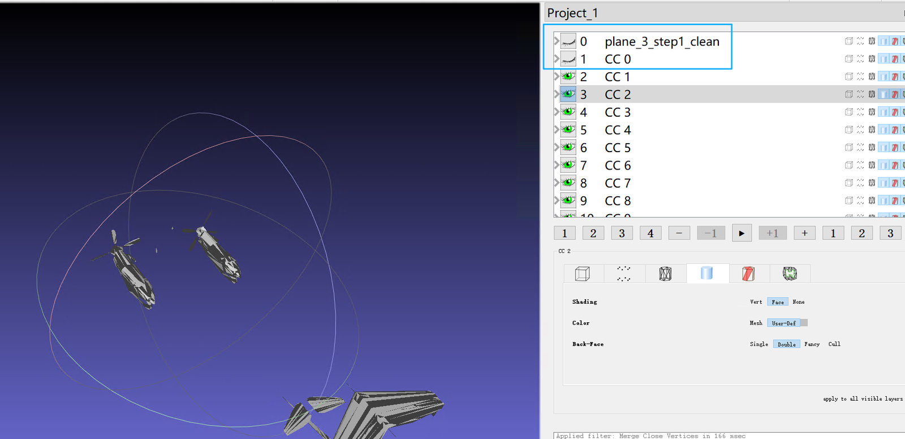
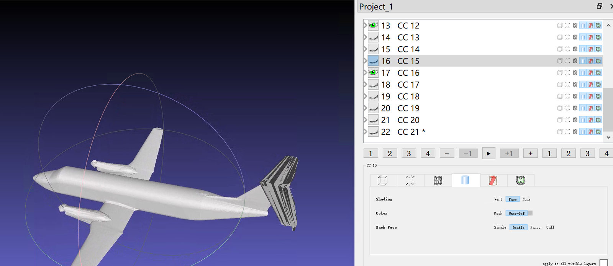
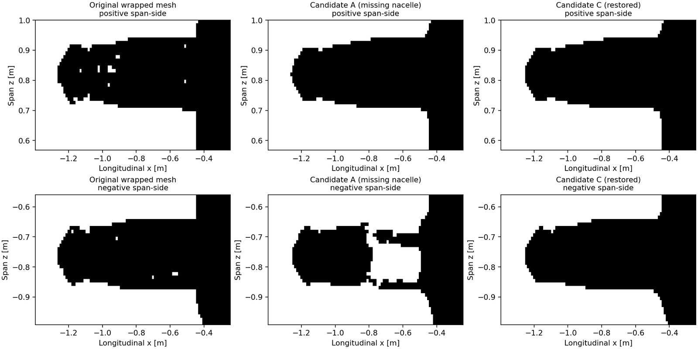

# MeshLab 图文教程：OBJ 清理、组件筛选与拓扑诊断

[返回中文首页](../README.zh-CN.md) · [Python 自动处理](../references/automation.md) · [FEKO 验收](feko-validation.zh-CN.md)

本教程使用作者在 **Plane-3 / Plane-4** 上实际截取的 MeshLab 界面。截图对应不同阶段和不同模型，**不可将某张截图的异常计数直接套用到其他网格**。菜单名称可能因 MeshLab 版本有所变化，可通过 `Ctrl+F` 搜索过滤器名称。

## 0. 先确认输入与备份

- `File → Import Mesh` 导入 `planeX.obj`；确认数据坐标单位（米或其他）。
- `File → Export Mesh As` 另存 `planeX_step0.obj`。不要覆盖原文件。
- 检查模型是否已缺失机身、主翼、尾翼、发动机等主要表面。若真实数据缺少整片翼面，后续细分不可能从数学上唯一恢复原始形状。

**示例：Plane-4 简化前的三角翼主轮廓及边界选择**



## 1. 保守清理（只改确定的错误）

进入 `Filters → Cleaning and Repairing`，按顺序执行：

1. `Remove Duplicate Vertices`
2. `Remove Duplicate Faces`
3. `Remove Zero Area Faces`
4. `Remove Unreferenced Vertices`

每执行一步记录三角面、顶点变化。若执行后飞机外表面消失，撤销并检查是否同时触发了删除面、删除连接等操作。

## 2. 正确显示实体表面

MeshLab 右侧 Visualization 面板：

- `Shading: Face`
- `Back-Face: Double`：显示面的两侧
- 关闭 `Wireframe`，保留实体表面显示

`Back-Face: Double` 有利于诊断法向/缺面问题，**不会修正面片绕序**。

## 3. 显示开放边与非流形边

按 `Ctrl+F`，分别搜索：

- `Select Border`：定位开放边界相关面/点
- `Select non Manifold Edges`：定位关联超过两个面的边及邻接三角面
- `Compute Topological Measures`：记录非流形边、开放边、连通组件及（仅在适用时）Genus





**警告**：红色是**选中标记**，其中包含非流形边周围的正常面；不能全选删除。某些零厚度 PEC 翼片具有有意开放的边界，不应只因为出现红色就自动封口。

若想清除红色选区，可搜索 `Select None`，选择清除面与顶点后 `Apply`；这不修改实际几何。

## 4. 只对极近顶点尝试焊接

先另存 `planeX_step2.obj`，按 `Ctrl+F` 搜索 `Merge Close Vertices`。



- `Merging distance (abs and %)` 就是阈值；左侧为**模型坐标单位**，右侧为百分比。
- 若模型单位为米，可以先试 `0.00001 m`（0.01 mm）。
- 记下日志 `Successfully merged N vertices`；若 N=0，说明在此阈值内未找到可合并顶点，**不要为了让 N 非零盲目加大容差**。
- 过大阈值可能把上下翼面或应分离的 PEC 表面错误焊接，改变电气连接。

## 5. 拆分连通组件以便人工判断

通过 `Ctrl+F` 搜索 `Split in Connected Components`。

- 取消 `Delete Source Mesh`（如有该选项）。
- 运行后在 Layers 面板逐一隐藏/显示 `CC 0, CC 1, ...`。
- 分辨机身、主翼、尾翼、发动机短舱、螺旋桨等；多组件**并不必然是错误**。



删除碎片前至少确认：是否为真实的天线、翼尖结构、控制面、发动机或薄片。若决定删除螺旋桨，应把模型标为**简化的无螺旋桨 PEC 目标**；必须在 FEKO、FK 投影和重建几何真值三处统一。



## 6. 合并需要保留的可见图层

- **隐藏原始完整图层**，避免把整个飞机叠加一次。
- 只显示已经确认要保留的 CC 图层。
- `Filters → Mesh Layer → Flatten Visible Layers`。
- 如有选项，保持源图层不删除；检查是否选择了“仅合并可见图层”。
- 导出 `planeX_simplified.obj`，重新运行 `Compute Topological Measures`。

**Flatten Visible Layers 只是合并到一个网格对象，并不会焊接翼身接缝，也不保证 PEC 电流连续。**

## 7. 先运行 Python 安全修复

```powershell
python scripts/mesh_pipeline.py audit "planeX_simplified.obj" --json "out/audit.json"
python scripts/mesh_pipeline.py clean "planeX_simplified.obj" --output "out/safe.obj" --json "out/clean.json" --orient-two-face-edges
```

可自动做无引用顶点删除、完全重复面/退化面删除及一致性可判定的绕序修复。**非流形边的真实物理连接需要额外判断**；不能对所有关联面执行 `Remove Faces`。

## 8. 什么情况下才用 Close Holes / watertight 重建？

`Close Holes` 的 `Max size to be closed` 通常是**边界环的边数**，不是毫米。对于零厚度翼片、长条形翼缘接缝或存在非流形分支的结构，全局填洞可能制造大面积虚假蒙皮。

只对已经检查清楚的、真实应该封闭的小孔局部处理；对于应连接的两条翼缘，需要在 CAD 或可靠几何脚本中建立对应边界的连接。若仍无法安全修复，才考虑有损体素包裹重建，并保留原网格作为几何参考。

## 9. 确认有损重建没有制造新错误

重建后至少检查：

- 开放边与非流形边（若目标确实是封闭实体）
- 是否有人为通道，Genus 与飞机结构是否一致
- 两台发动机是否均完整、是否发生错误融合/截断
- 薄翼厚度、翼尖、机翼前后缘及翼身连接
- 三视图轮廓；IoU 高**不能证明厚度准确**



前一次 Plane-3 水密候选曾出现 Genus=955，之后过度删碎片又造成一侧短舱缺失；见 [案例说明](cases.zh-CN.md)。

## 10. 交给 FEKO 验收

保存候选版本及 `repair_log.json`，交给 [FEKO 验收教程](feko-validation.zh-CN.md)。未完成 FEKO 和电磁网格收敛前，不应标注为“已完成全波验证”。
